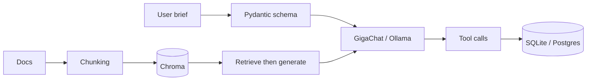

# ship-ai-sandbox

### **LLM in the product — not in the chat.**

[](https://www.python.org/)
[](#-lessons)
[](https://developers.sber.ru/studio)
[](https://ollama.com)
[](https://github.com/anatoly-kulishov/ship-ai-sandbox/pulls)

[Lessons](#-lessons) · [Quick start](#-quick-start) · [Theory](docs/theory/README.md) · [Learning plan](docs/LEARNING_PLAN.md) · [YouTube](docs/YOUTUBE_SEARCH.md)

---

Песочница **AI Application Engineer**: structured output, Pydantic validation, tool calling, local LLMs (Ollama), RAG, FastAPI, async, PostgreSQL — на практике, урок за уроком.

С телефона удобнее читать **один урок** (ссылки ниже). Код и Gradio-hub — с компьютера.

**Keywords:** AI Application Engineer, structured output, Pydantic, function calling, GigaChat, Ollama, RAG, Chroma, LangChain, FastAPI, asyncio, embeddings, GGUF.

---

## Why this repo?

| Without a sandbox | With ship-ai-sandbox |
| :--- | :--- |
| LLM отвечает «текстом», схема ломается в проде | JSON + Pydantic на каждом шаге |
| Tool calling — магия из доки | Свой `save_note` → SQLite, прозрачный цикл |
| RAG = «подключил LangChain» | Сначала свой retrieve, потом тонкий LangChain |
| Теория отдельно от кода | Урок = конспект + runnable check |

### How it fits together



---

## Lessons

| # | Lesson | What you ship |
| -: | :----- | :------------ |
| 01 | [Note sorter](docs/01-note-sorter.md) | Text → JSON, Pydantic validates |
| 02 | [Tool use](docs/02-tool-use.md) | Model calls `save_note` → SQLite |
| 03 | [Ollama](docs/03-ollama.md) | Same sorter, local model |
| 04 | [Gym plan](docs/04-gym-plan.md) | Brief → plan, catalog ids only |
| 05 | [RAG](docs/05-rag.md) | Retrieve exercises by meaning, then plan |
| 06 | [GGUF](docs/06-gguf.md) | Q4/Q8, RAM for 7B/14B |
| 07 | [FastAPI](docs/07-fastapi.md) | Same plan over HTTP + Swagger |
| 08 | [Asyncio](docs/08-asyncio.md) | AsyncOpenAI gateway stays responsive |
| 09 | [Chunking](docs/09-chunking.md) | Docs → chunks with overlap + `source` |
| 10 | [Chroma RAG](docs/10-chroma-rag.md) | Embeddings + “I don’t know” |
| 11 | [LangChain RAG](docs/11-langchain-rag.md) | Same RAG via thin LangChain |
| 12 | [PostgreSQL](docs/12-postgres.md) | LLM call → `events` JSONB row |

Next on the plan: Redis, agents, Docker — see [LEARNING_PLAN.md](docs/LEARNING_PLAN.md).

Also: [Theory](docs/theory/README.md) · [Ed Donner map](docs/sources/ed-donner.md) · [Gradio hub](docs/gradio-hub.md) · [CONTINUE](docs/CONTINUE.md)

---

## Quick start

```bash
git clone https://github.com/anatoly-kulishov/ship-ai-sandbox.git
cd ship-ai-sandbox
python3 -m venv .venv
source .venv/bin/activate
pip install -r requirements.txt
cp .env.example .env
```

GigaChat key: [Sber Developers Studio](https://developers.sber.ru/studio) → API → Authorization key → `.env` as `GIGACHAT_API_KEY`. **Never commit `.env`.**

```bash
npm run hub                 # all lessons, http://localhost:8501
npm run 09                  # chunking lesson
npm run check:09
npm run ollama:start
ollama pull nomic-embed-text
npm run check:10:ingest && npm run check:10
npm run check:11:ingest && npm run check:11
npm run postgres:up
npm run check:12
```

**Hub:** Gradio navbar by lesson. Accordion **Конспект урока** = text from `docs/`.

---

## Remember

1. Product LLM answers with a **schema**, not a paragraph.
2. Prompt = rules. Validation = **your code** (Pydantic, whitelist).
3. Retrieve first (catalog or docs), then generate.
4. Chunking → vector store → say “don’t know” if it’s not in context.
5. LangChain after your own RAG — not instead of it.

---

## FAQ

**Is this a chatbot tutorial?**  
No. Focus is application engineering: schemas, tools, retrieval, APIs.

**Do I need GigaChat?**  
Lessons 01–02 expect it. Local path starts at 03 (Ollama).

**Can I fork for a course / team?**  
Yes. Educational repo — fork freely. Lecture ideas partly from Ed Donner (MIT) — see [sources](docs/sources/ed-donner.md).

---

## Contributing

PRs that fix checks, clarify docs, or add the next lesson from the plan are welcome.

---

**If this sandbox helps — ⭐ the [repo](https://github.com/anatoly-kulishov/ship-ai-sandbox).**
